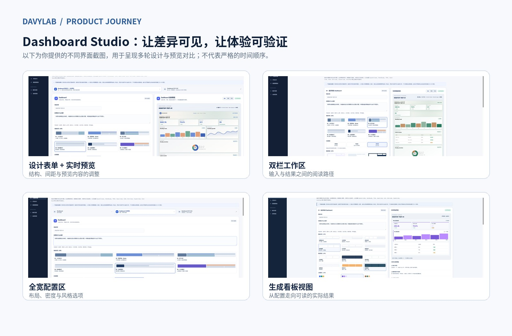
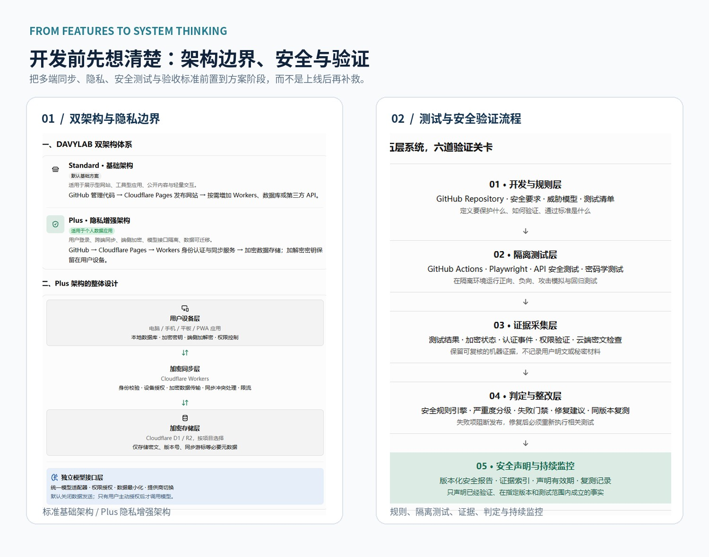
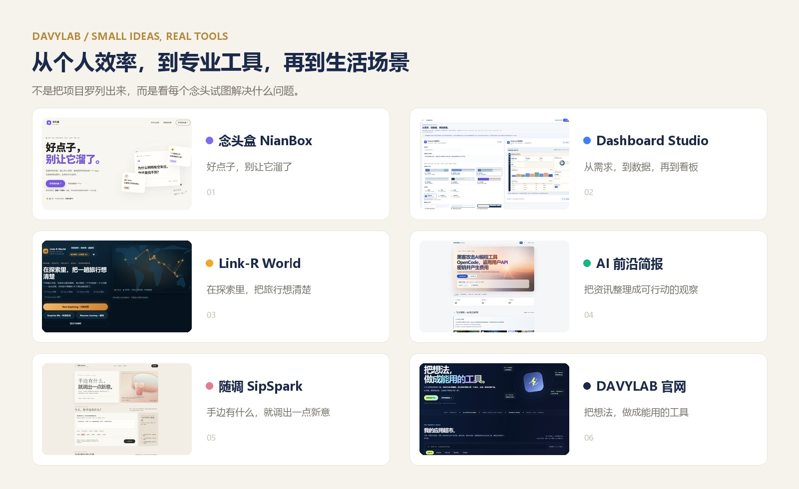

# 我用 AI 做了几个应用后，才发现：能生成，不等于能用

*一个从 AI 小白起步的人，如何从着急生成，走向先规划、再开发、持续验证。*

最初开始用 AI 做应用时，我的思路很直接：脑子里有个想法，就马上和 AI 说，让它先做出来再看。

页面出来了，发现不对，就继续提修改意见；改完一处，又发现另一处需要调整。对话一轮接一轮，看起来项目一直在向前走，但不少时间和 Token，其实消耗在反复修补那些原本可以提前想清楚的问题上。

那时候，我常常以为，只要把要求描述得再细一点，结果就会更好。

后来在一个个产品尝试中，我逐渐意识到：**有时问题不在于 AI 写得不够快，而在于我还没想清楚，就急着让它开始做。**

这也是我这段 AI 转型历程里，最重要的一次变化。

## 从 AI 小白起步：先做出来，再边做边改

我一直对新知识有好奇，也愿意持续学习新技术。开始接触 AI 后，这份好奇不再只停留在了解工具、研究功能上，我开始尝试把自己观察到的问题和脑海中的想法，变成真正可以打开、可以操作的产品。

念头盒 NianBox、Dashboard Studio、Link-R World、AI 前沿简报、随调 SipSpark、暖间地图，以及 DAVYLAB 自己的网站，来自不同的场景：有的是记录灵感，有的是帮助整理和呈现数据，有的关注旅行、生活服务或信息获取。

它们并不是同一种产品，也不是每一个都已经打磨到最终状态。但这些尝试让我有机会不断练习：如何描述一个需求，如何和 AI 一起拆解问题，又该如何判断一个结果究竟好不好。

初期我更在意“先把东西做出来”。有时需求还不够清楚，就直接进入生成和修改；功能不符合预期，再补充要求。这样确实能很快看到一个雏形，却也容易陷入局部修改：改了页面，才发现流程不顺；补了功能，才发现整体结构需要重新考虑。

我渐渐明白，**生成一个版本，是开始，不是交付。**

## 真正的进步，是学会先和 AI 把问题聊清楚

现在再开始一个项目，我会刻意放慢最初那一步。

我先和 AI 讨论，而不是第一句话就要求它写代码。我们需要先把几件事聊清楚：

- 这个产品究竟要解决什么问题？谁会在什么场景下使用？
- 用户完成最重要的一件事，最短路径应该是什么？
- 第一版必须做好什么，哪些功能可以先不做？
- 产品由哪些模块组成，模块之间如何协作？
- 开发之前有哪些风险、依赖和验收条件需要确定？

当这些问题逐渐清楚后，我再和 AI 一起梳理产品架构、开发思路、实现步骤和测试方式。必要时先形成方案和检查清单，确认方向，再进入具体开发。

这不是说计划越长越好，也不是每个小工具都必须做一套复杂的技术设计。真正重要的是，让与产品成败有关的关键决定尽量发生在编码之前。

**我不再只问 AI“怎么把它做出来”，而是先问“我们到底要做什么，怎样才算做好”。**

这个转变也让我在对话中学到更多。每次讨论一个模块、一种数据处理方式或一个交互流程，我都会更清楚地理解背后的原因。AI 不再只是接收命令的工具，也成为我学习新知识、检验思路、发现盲点的对话伙伴。

## 从一个页面，开始考虑完整的产品

这种变化，在 Dashboard Studio 的开发中尤其明显。

它不只是生成一张看板图片。用户需要描述需求、选择布局与视觉风格、查看预览，再决定结果是否符合预期。因此，表单结构、布局差异、信息层级、页面对齐、滚动时的留白、文字与背景的对比度，以及不同尺寸下的体验，都不是可有可无的装饰。

我把不同界面版本放在一起比较，也会继续追问：不同布局是否真的有区别？选项名称是否容易理解？预览与配置之间是否对应？页面看起来漂亮的同时，文字是否清楚、操作是否顺手？

有时候，问题并不是“页面打不开”，而是页面可以使用，却离真正好用还有距离。只有把问题明确说出来，回到实际页面检查，再根据结果调整，才知道修改是否有效。

下面这组截图来自 Dashboard Studio 开发过程中的不同界面版本，展示的是布局、配置方式和预览呈现等方面的设计探索。它们不是为了证明每个版本都已经完美，而是记录我如何把“看起来不对”逐渐拆成可以讨论、可以检查、可以继续改进的具体问题。

*图：开发过程中的界面方案对比。重点不只是页面变化，而是逐步明确结构、布局、信息密度与预览体验。*

## 在开发之前，把多端、隐私、安全和稳定性想进去

另一个明显的变化，是我开始把过去容易留到后面处理的问题，提前放进产品设计。

一个应用可能需要在电脑、手机和平板之间使用，记录是否能够顺畅同步？涉及个人数据时，数据保存在哪里？哪些信息必须保留，哪些可以尽量少收集？如果产品调用 AI 模型，模型接口、权限和数据传输又应该如何管理？

这些问题不应等到功能已经堆起来后，才发现需要大幅返工。

我开始在方案阶段区分基础架构与隐私增强架构，提前讨论身份认证、同步服务、加密存储、客户端密钥，以及独立的模型接口层；也开始考虑如何通过隔离测试、保存可复核的证据、执行安全规则和回归测试，判断开发结果是否符合预期。

*图：方案设计中的基础架构与隐私增强思路，以及分层测试和验证流程。它们表达的是设计与验收方法，并不意味着所有安全能力已经完成生产环境验证。*

对我来说，这代表思考方式从“功能能不能加上”，逐渐走向“系统应该如何可靠地工作”。

我也提醒自己：**架构图不是安全证明，AI 说完成了也不是验收结论。** 设计要靠实现落地，结果要经过测试，关键功能需要在真实环境中核对。没有验证过的能力，就不能因为它写在方案里而被当作已经实现。

## 我做的，不只是一个应用

把这些项目放在一起看，我发现自己真正积累的，并不只是几个页面或几个功能。

念头盒让我思考，如何降低记录想法的门槛；Dashboard Studio 让我练习把复杂需求拆成配置、布局和预览；Link-R World 让我尝试把旅行中的探索与路线规划组织起来；AI 前沿简报让我持续练习信息整理与判断；随调 SipSpark 和暖间地图，则来自生活中完全不同的使用场景。

它们还在各自的阶段中，有些需要继续验证、调整或完善。我更愿意把它们看作一组真实的产品实践，而不是一张“已经全部成功”的项目清单。

*图：来自不同场景的产品尝试。对我而言，每个项目都是一次学习需求、产品思维、实现方式和用户体验的机会。*

这些项目也让我更清楚地看到：AI 开发不是一句提示词就能代替所有工作。它降低了尝试和制作的门槛，但仍然需要有人理解问题、做出取舍、判断体验、关注安全，并承担最终验收的责任。

## 我想持续练习的，是一套更可靠的方法

回头看，我的变化并不是突然学会了某个神奇技巧，而是在持续对话、开发、发现问题和修正的过程中，逐渐形成了一套更适合自己的做事方式：

**先理解需求，再确定目标；先规划结构，再进入开发；边做边验证，最后回到真实使用中继续迭代。**

这套方法不是一成不变的流程。小项目可以轻一些，复杂项目就需要更认真地规划。真正重要的是，不再把“生成结果”当成终点，而是把用户是否能理解、是否能使用、是否可靠稳定，放在更重要的位置。

我对 AI 的转型，始于对新知识的渴望，也依靠持续学习一步步推进。现在我仍然在学，也会继续遇到不会的问题。区别是，我开始更懂得怎样提出问题、怎样与 AI 协作、怎样把模糊的想法整理成可执行的计划，以及怎样用实际结果检验自己的判断。

这也是我创建 DAVYLAB 的原因。

**把想法，做成能用的工具。**

我希望这里记录的不只是做成了什么，还包括怎么开始、如何规划、遇到了什么问题、又是怎样改进的。既分享工具，也分享实践；既记录成果，也不回避尚未完成的部分。

如果你也对 AI、新技术和创造产品有兴趣，欢迎一起交流。你不必一开始就知道所有答案，可以先从一个真正想解决的小问题开始。

有了一个念头之后，下一步不是急着把它变成代码，而是先把它想清楚。

然后，再一步步做出来。

—— DAVYLAB
